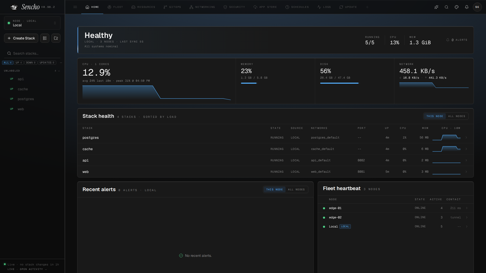
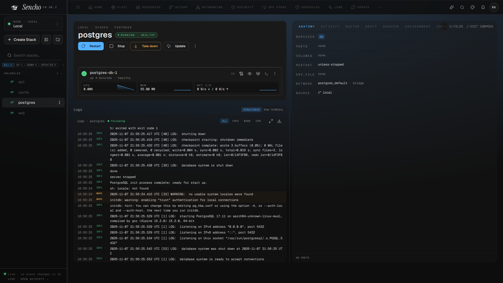
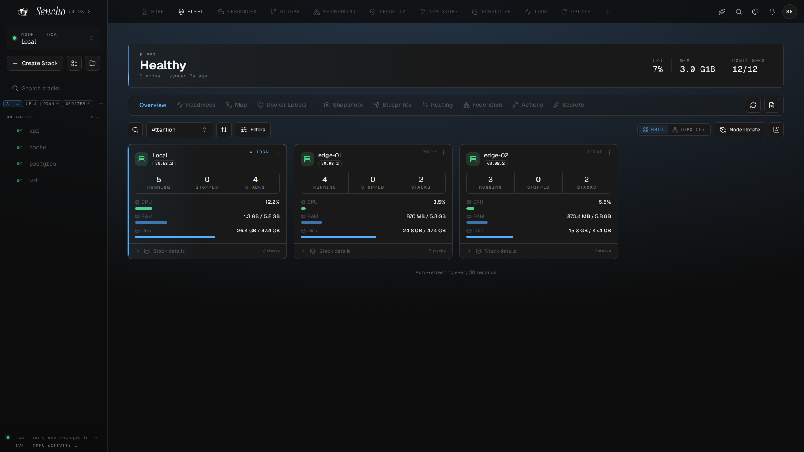
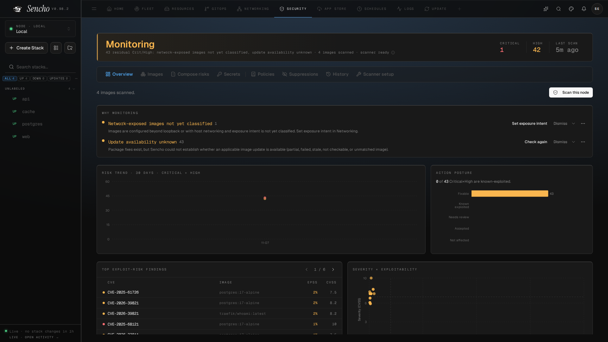
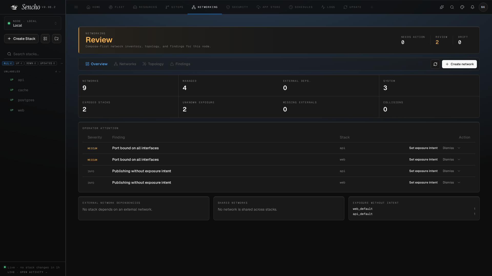

<div align="center">
  <picture>
    <source media="(prefers-color-scheme: dark)" srcset="frontend/public/sencho-logo-dark.svg">
    
  </picture>

  ### Self-hosted Docker Compose management for one machine or a fleet.

  <p>
    <a href="https://docs.sencho.io">Docs</a> ·
    <a href="https://docs.sencho.io/tutorials">Tutorials</a> ·
    <a href="https://sencho.io">Website</a> ·
    <a href="https://sencho.io/roadmap">Roadmap</a> ·
    <a href="https://github.com/studio-saelix/sencho/discussions">Discussions</a> ·
    <a href="https://github.com/sponsors/Studio-Saelix">Sponsor</a> ·
    <a href="https://buymeacoffee.com/sencho">Buy Me a Coffee</a>
  </p>

  [](https://github.com/studio-saelix/sencho/releases)
  [](https://hub.docker.com/r/saelix/sencho)
  [](https://github.com/studio-saelix/sencho/actions/workflows/ci.yml)
  [](LICENSE)
</div>

<br />

<picture>
  <source media="(prefers-color-scheme: light)" srcset="docs/images/readme/hero-light.png">
  
</picture>

---

## What Sencho is

Sencho is a Docker Compose control plane for DevOps engineers, platform teams, system administrators and homelab users. It gives you a graphical interface for deploying, editing, watching and recovering Compose stacks, without giving up file-on-disk workflows: your compose files stay on the host and remain the source of truth.

It runs as a single container. To manage more machines, install Sencho on each one and connect them with an API token; the primary dashboard then proxies authenticated HTTP and WebSocket requests across your fleet. There is no SSH and no remote Docker socket, and nodes behind NAT can connect outbound with the Pilot Agent.

Sencho is free, open-source software under AGPLv3. Everything described here is included in the Community tier, with unlimited nodes and users.

## Highlights

- **Your Compose files stay yours.** Edit with a diff preview before you save, deploy, and roll back to any earlier deploy. [Stack management](https://docs.sencho.io/features/stack-management)
- **Many machines, no SSH.** One dashboard for every node, with [Fleet view](https://docs.sencho.io/features/fleet-view), remote updates and the [Pilot Agent](https://docs.sencho.io/features/pilot-agent) for hosts behind NAT. [Multi-node](https://docs.sencho.io/features/multi-node)
- **Deploys you can undo.** [Atomic deployments](https://docs.sencho.io/features/atomic-deployments) roll back on failure, and [health-gated updates](https://docs.sencho.io/features/health-gated-updates) hold a rollout until your health checks pass.
- **Git-driven fleets.** Sync stacks from a repository, roll out [Blueprints](https://docs.sencho.io/features/blueprint-model) across nodes, and see [drift](https://docs.sencho.io/features/stack-drift) the moment a running stack stops matching its source. [GitOps](https://docs.sencho.io/features/gitops-overview)
- **Know what you run.** Vulnerability scanning with Trivy, scan policies that can block a deploy, and [Compose Doctor](https://docs.sencho.io/features/compose-doctor) preflight checks. [Security](https://docs.sencho.io/features/security)
- **Get back to working.** A [recovery guide](https://docs.sencho.io/operations/recovery) for when Sencho, a deploy, sign-in, Docker or a node fails.

There is more: SSO and RBAC, alerts and notification routing, scheduled operations, a host console, an App Store, and a REST API. See the [full feature guide](https://docs.sencho.io/features/overview).

## Works with AI clients

[sencho-mcp](https://github.com/Studio-Saelix/sencho-mcp) is a read-only [Model Context Protocol](https://modelcontextprotocol.io) server for your Sencho hub. An MCP client can ask about nodes, stacks, container health and update readiness through five observation tools. It uses an Observe Only token that cannot change anything, read secrets or open a shell. See the [MCP server guide](https://docs.sencho.io/features/mcp).

---

## Quick start

Sencho talks to Docker through the host's `/var/run/docker.sock`. Mounting it grants Sencho the same privilege as `sudo docker` on the host, which is the model Portainer, Dockge and Komodo use too. See [running with a non-root container user](https://docs.sencho.io/getting-started/configuration#container-user) if you need stricter isolation.

```yaml
services:
  sencho:
    image: saelix/sencho:latest
    container_name: sencho
    restart: unless-stopped
    ports:
      - "1852:1852"
    volumes:
      - /var/run/docker.sock:/var/run/docker.sock
      - ./data:/app/data
      # 1:1 Compose Path Rule: the host path MUST match the container path
      - /opt/docker:/opt/docker
    environment:
      - COMPOSE_DIR=/opt/docker
      - DATA_DIR=/app/data
```

```bash
docker compose up -d
```

Open `http://your-server:1852` and create your admin account. In production, put Sencho behind a TLS-terminating reverse proxy; the [self-hosting guide](https://docs.sencho.io/operations/self-hosting) covers hardening, environment variables and reverse-proxy examples.

<details>
<summary>Run with <code>docker run</code> instead</summary>

```bash
docker run -d --name sencho \
  -p 1852:1852 \
  -v /var/run/docker.sock:/var/run/docker.sock \
  -v sencho_data:/app/data \
  # 1:1 Compose Path Rule: the host path MUST match the container path
  -v /opt/docker:/opt/docker \
  -e COMPOSE_DIR=/opt/docker \
  saelix/sencho:latest
```

</details>

For the full walkthrough, see the [quickstart guide](https://docs.sencho.io/getting-started/quickstart). To manage a second machine, install Sencho on it the same way and add it from the primary dashboard; see the [multi-node guide](https://docs.sencho.io/features/multi-node).

---

## Screenshots

| | |
|---|---|
|  |  |
|  |  |

---

## Telemetry and data handling

Sencho does not emit telemetry, analytics, or crash reports, and makes no outbound calls to Sencho-controlled endpoints. Stack metadata, container inventory, and user activity never leave your instance. The web UI, including its typefaces, is served by the instance.

## Admiral

**Admiral** is Studio Saelix's paid business assurance plan on top of everything in Community: Hardened Build, priority support, and governance depth such as LDAP / Active Directory and full audit log export. See [sencho.io/pricing](https://sencho.io/pricing) for current plan details.

---

## Documentation, community, and license

- **Documentation:** [docs.sencho.io](https://docs.sencho.io) · **Blog:** [sencho.io/blog](https://sencho.io/blog)
- **If something breaks:** the [Recovery guide](https://docs.sencho.io/operations/recovery)
- **Community:** [GitHub Discussions](https://github.com/studio-saelix/sencho/discussions)
- **Contributing:** [CONTRIBUTING.md](CONTRIBUTING.md)
- **Security:** [SECURITY.md](SECURITY.md). Do not open public issues for security vulnerabilities.
- **License:** [GNU Affero General Public License v3.0](LICENSE) (`AGPL-3.0-only`). Copyright (c) 2026 Studio Saelix. See [Licensing](https://docs.sencho.io/features/licensing) for terms and [TRADEMARKS.md](TRADEMARKS.md) for trademarks.

<div align="center">

[](https://github.com/studio-saelix/sencho/graphs/contributors)

</div>
